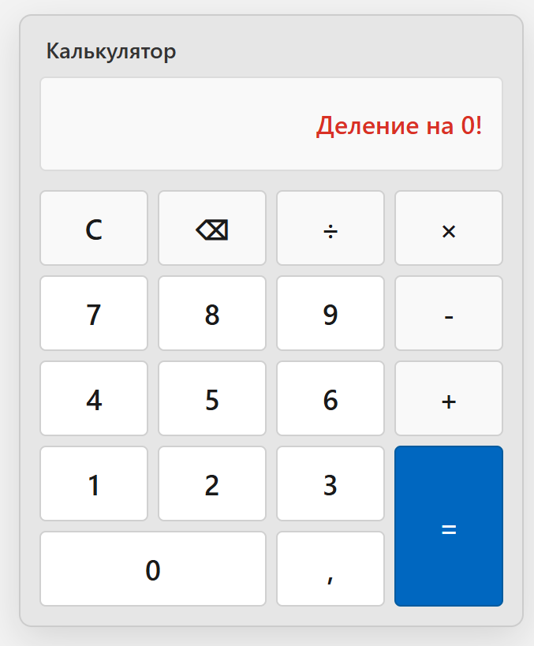
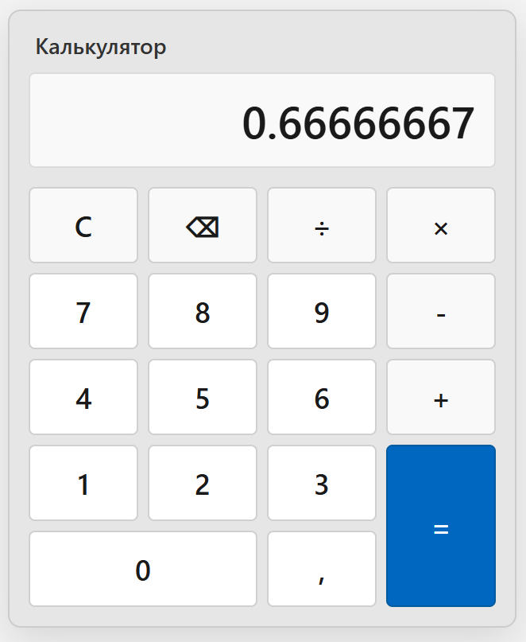

# Windows-style calculator на Flask

- [Windows-style calculator на Flask](#windows-style-calculator-на-flask)
  - [Задание](#задание)
  - [Структура проекта](#структура-проекта)
  - [Требования](#требования)
  - [Тесты](#тесты)
  - [Запуск приложения](#запуск-приложения)
  - [Скриншоты](#скриншоты)
  - [Используемые технологии](#используемые-технологии)
    - [модуль ast](#модуль-ast)
    - [модуль operator](#модуль-operator)
  - [Ввод с клавиатуры](#ввод-с-клавиатуры)


см. также [Windows-style calculator на FastAPI](../calc_fastapi/Readme.md)

## Задание

Цель: Создать  web-версию калькулятора
Описание задания:
Создать интерфейс вэб-страницы с кнопками, напоминающий windows калькулятор и
реализовать обработку событий – кликаем на цифру – цифра выводится в текстовом
поле, кликаем на знак операции – он появляется после цифры в текстовом поле.
После клика на кнопку «=» выводим результат операции на страницу.

## Структура проекта

```text
calculator_web/
├── app/
│   ├── __init__.py          # Фабрика приложения Flask и веб-эндпоинты
│   ├── core/
│   │   ├── __init__.py
│   │   └── calculator.py    # ООП бизнес-логика (безопасное ядро вычислений)
│   ├── static/
│   │   ├── css/
│   │   │   └── style.css    # Стили калькулятора в стиле Windows
│   │   └── js/
│   │       └── app.js       # Клиентская логика (клики, отправка AJAX-запросов)
│   └── templates/
│       └── index.html       # HTML-разметка интерфейса
├── tests/
│   ├── __init__.py
│   └── test_calculator.py   # Pytest unit-тесты для сервиса калькулятора
├── run.py                   # Точка запуска Flask-сервера
└── requirements.txt
```

## Требования

Python 3.12

`pip install -r requirements.txt`

## Тесты

`PYTHONPATH=final/calc_flask pytest final/calc_flask`

## Запуск приложения

`python run.py`

http://127.0.0.1:5000/

## Скриншоты





## Используемые технологии

модули ast и operator позволяют вычислять математические выражения безопасно, не используя опасную встроенную функцию eval()

### модуль ast

import ast (Abstract Syntax Tree / Абстрактное синтаксическое дерево)

Зачем нужен: Модуль ast превращает обычную строку (например, "2 + 3 * 4") в древовидную структуру Python-объектов (дерево операций).

Его задача: проверяет строку на синтаксическую корректность без выполнения кода.

Почему это важно: Если передать в eval("__import__('os').system('rm -rf /')"), сервер исполнит вредоносную команду. А ast.parse() просто построит дерево из узлов. Мы жестко разрешаем обрабатывать только узлы чисел и четырех базовых операций (+, -, *, /). Все остальные попытки выполнить сторонний код отсекаются.

### модуль operator

import operator
Зачем нужен: Предоставляет стандартные арифметические функции Python в виде обычных функций:

operator.add(a, b) — аналог a + b

operator.sub(a, b) — аналог a - b

operator.mul(a, b) — аналог a * b

operator.truediv(a, b) — аналог a / b

Его задача: Связать узел из AST-дерева с реальным математическим действием. Создаем словарь-маппинг:

```
_OPERATORS = {
    ast.Add: operator.add,
    ast.Div: operator.truediv,
    # ...
}
```

И когда ast находит узел сложения ast.Add, мы берём соответствующую функцию operator.add и вызываем её.

## Ввод с клавиатуры

реализован в `app.js`

дополнительно ко вводу мышью

Маппинг клавиш:

- 0-9 — ввод цифр.
- +, -, *, / — ввод математических знаков.
- , или . — автоматическое добавление точки.
- Enter или = — запрос вычисления.
- Backspace — удаление последнего введенного символа.
- Escape или C / c — полный сброс дисплея.

event.preventDefault() — гарантирует, что нажатие Enter не вызовет перезагрузку страницы или повторное нажатие активных UI-элементов.
