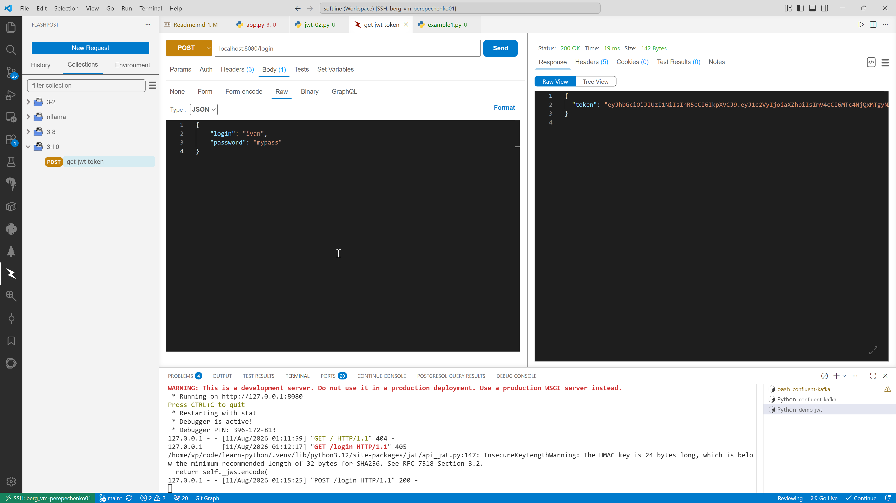
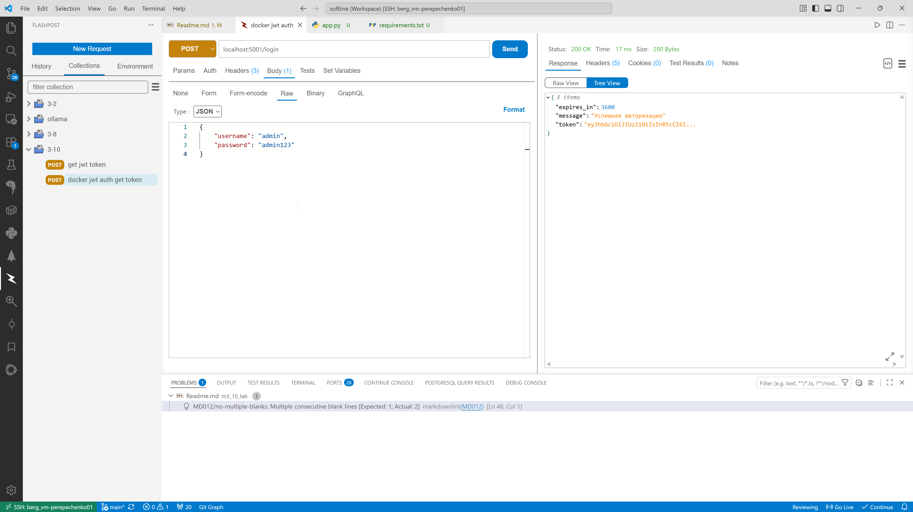
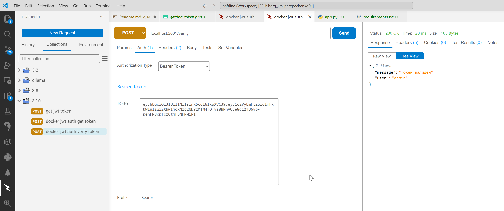
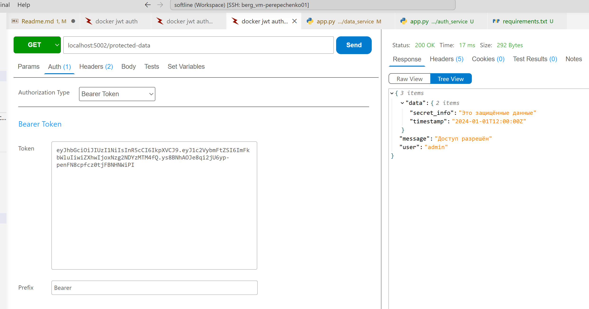
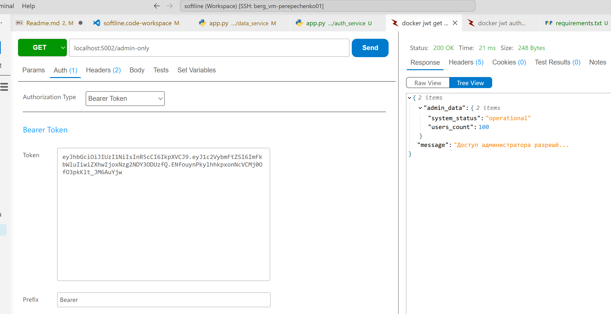

# Lab 3.10

## Интеграционные тесты

0.01.29

```
/home/vp/code/learn-python/.venv/bin/python /home/vp/code/learn-python/m3_10_lab/integration-tests.py
.....
----------------------------------------------------------------------
Ran 5 tests in 17.068s

OK
```

## Аутентификация и авторизация - теория

0.31.35

## Практика

### example1.py

0.53.58

отдельная устаревшая библиотека с совершенно другим API. В ней действительно нет метода encode

`pip install jwt`

Правильная библиотека:

`pip install PyJWT`

import jwt

>Важно: Название библиотеки для установки через pip — PyJWT (с заглавными буквами), но внутри Python-кода модуль всегда импортируется как import jwt

import secrets - для генерации случайных ключей автоматически

### m3_10_lab/demo_jwt/jwt-02.py

Цель этого микросервиса – выдать нам токен.

/home/vp/code/learn-python/.venv/bin/python /home/vp/code/learn-python/m3_10_lab/demo_jwt/jwt-02.py



### m3_10_lab/demo_jwt/real

01.16.25

В первом микросервисе создаем токен, а во втором микросервисе проверяем доступ к системе.

#### auth_service.py

http://127.0.0.1:5000/login

При входе на страницу будет показана форма. Вводим логин и пароль.
Кликаем на кнопку «Войти».

Перенаправляем на endpoint login.

#### hello_service.py

1.20.37

Ключ используем тот же, что и в первом микросервисе (симметричное шифрование).

Открывается страничка, вводим токен, который получили в первом микросервисе.

получаем расшифрованный логин

### m3_10_lab/demo_jwt/auth_service/app.py

1.25.23

секретный ключ храним в .env файле

### Реальный проект по работе с JWT

1.28.50

m3_10_lab/demo_jwt/JWT

Также здесь будет показано взаимодействие между микросервисами.

Для этого каждое microservice упаковываем в образ Docker.

m3_10_lab/demo_jwt/JWT/auth_service - выдает токен пользователю

m3_10_lab/demo_jwt/JWT/data_service - А этот микросервис на основе токена получает доступ к каким-то ресурсам.

```
(.venv) ✔ ~/code/learn-python/m3_10_lab/demo_jwt/JWT [main|✚ 5…3] 
17:21 $ docker compose up -d

(.venv) ✔ ~/code/learn-python/m3_10_lab/demo_jwt/JWT [main|✚ 5…3] 
17:21 $ docker compose ps
NAME               IMAGE              COMMAND                  SERVICE        CREATED          STATUS                             PORTS
jwt-auth-service   jwt-auth-service   "gunicorn --bind 0.0…"   auth-service   48 seconds ago   Up 48 seconds (health: starting)   0.0.0.0:5001->5001/tcp
jwt-data-service   jwt-data-service   "gunicorn --bind 0.0…"   data-service   48 seconds ago   Up 48 seconds (health: starting)   0.0.0.0:5002->5002/tcp
```

```
# Декоратор для проверки валидности JWT токена
def token_required(f):
    @wraps(f)
```

Типа у нас есть функции, которые можно запускать не всем, а только тем, у кого есть JWT токен. Например:

```
# Маршрут для проверки токена
@app.route('/verify', methods=['POST'])
@token_required
def verify_token(current_user):
```

Получение токена в сервисе выдачи токенов



Проверка токена в сервисе выдачи токенов



получение защищенных данных

localhost:5002/protected-data



Доступ с правами администратора


