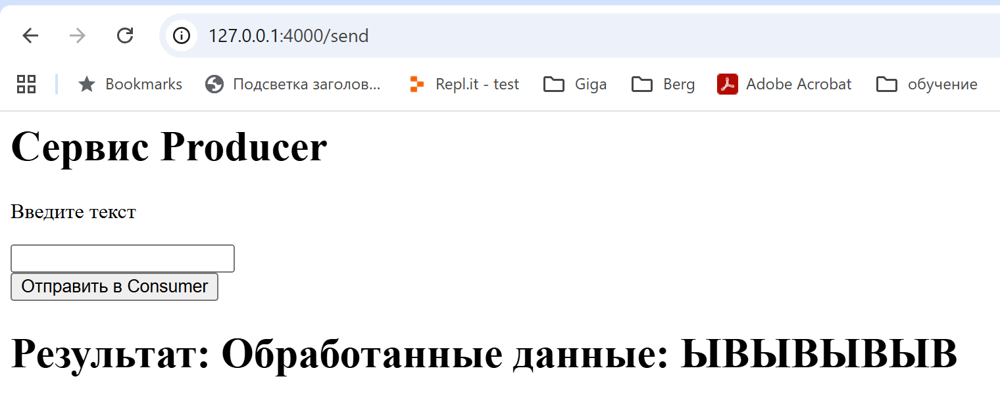

# Lab 3.11

- [Lab 3.11](#lab-311)
  - [Генераторы](#генераторы)
    - [nd json](#nd-json)
  - [асинхронные функции](#асинхронные-функции)
    - [m3\_11\_lab/async/example1.py](#m3_11_labasyncexample1py)
    - [m3\_11\_lab/async/example2.py](#m3_11_labasyncexample2py)
    - [m3\_11\_lab/async/example3.py](#m3_11_labasyncexample3py)
    - [m3\_11\_lab/async/work\_example.py](#m3_11_labasyncwork_examplepy)
    - [m3\_11\_lab/async/real\_example.py](#m3_11_labasyncreal_examplepy)
    - [m3\_11\_lab/async/ping\_async\_devices.py](#m3_11_labasyncping_async_devicespy)
  - [Взаимодействие между микросервисами](#взаимодействие-между-микросервисами)
    - [m3\_11\_lab/exchange\_data/producer/app.py](#m3_11_labexchange_dataproducerapppy)
    - [m3\_11\_lab/exchange\_data/consumer](#m3_11_labexchange_dataconsumer)
  - [Подготовка к техническому собеседованию](#подготовка-к-техническому-собеседованию)
    - [PostgreSQL](#postgresql)
      - [анонимные блоки в PostgreSQL](#анонимные-блоки-в-postgresql)
      - [Примеры процедур](#примеры-процедур)
      - [Отличия хранимой процедуры от анонимного блока](#отличия-хранимой-процедуры-от-анонимного-блока)
    - [Rest API](#rest-api)
    - [брокеры очередей сообщений](#брокеры-очередей-сообщений)
    - [microservices](#microservices)
    - [тесты](#тесты)
    - [NoSQL](#nosql)
    - [2.39.43](#23943)
    - [Партиционирование баз данных](#партиционирование-баз-данных)
  - [Бизнес-процессы](#бизнес-процессы)
  - [Code-First) и стандарте (OpenAPI / Swagger)](#code-first-и-стандарте-openapi--swagger)

## Генераторы

m3_11_lab/generators

0.10.39

yield i 

оператор yield возвращает одно значение и приостанавливает функцию. Аналог Return, но вместо выхода приостанавливает функцию. Возвращает генератор.

m3_11_lab/generators/read_csv.py

### nd json

0.32.00 

Специальный формат для Big Data, без запятых и квадратных скобок.

Все храним целиком в память, а считываем построчно.

```
{"id": 1,"title": "Audi","price": 1000}
{"id": 2,"title": "BMW","price": 2000}
{"id": 3,"title": "VW","price": 900}
{"id": 4,"title": "Skoda","price": 910}
```

m3_11_lab/generators/read_big_json.py

0.33.33

## асинхронные функции

0.36.45

m3_11_lab/async

### m3_11_lab/async/example1.py

0.42.31

### m3_11_lab/async/example2.py

0.45.50

### m3_11_lab/async/example3.py

0.49.00

### m3_11_lab/async/work_example.py

0.55.25

### m3_11_lab/async/real_example.py

01.03.52

FastAPI – это веб-фреймворк, максимально поддерживающий асинхронность, в отличие от Flask.

### m3_11_lab/async/ping_async_devices.py

01.13.54

асинхронный ping устройств

## Взаимодействие между микросервисами

1.32.48

m3_11_lab/exchange_data

m3_11_lab/exchange_data/producer

### m3_11_lab/exchange_data/producer/app.py

1.35.43

### m3_11_lab/exchange_data/consumer

1.48.10

`docker-compose up --build`

1.58.58

отправка данных из producer  to consumer



## Подготовка к техническому собеседованию

2.21.02

### PostgreSQL

#### анонимные блоки в PostgreSQL

2.30.34

```psql
DO $$
    DECLARE # что дано
        person record; # переменная person с типом данных record
BEGIN // начало программы
    SELECT * INTO person FROM person WHERE id_person=1; // вставляем всю строку в переменную person
    // person станет объектом и к каждому элементу можно будет обращаться через точку.

    // То же самое, что print в Python. Печатаем на экран.
    RAISE NOTICE 'Имя сотрудника: %, оклад: %', person.fio, person.salary;
END $$
```

#### Примеры процедур

```sql
-- Создание процедуры
CREATE OR REPLACE PROCEDURE hello()
LANGUAGE plpgsql
AS $$
BEGIN
    RAISE NOTICE 'Добрый день!';
END;
$$;

-- Вызов процедуры
CALL hello();

-- Для вывода всех существующих хранимых процедур используйте:
SELECT * FROM pg_proc WHERE prokind = 'p';
```

```sql

-- Создание процедуры с параметрами
CREATE OR REPLACE PROCEDURE calc_mult(a int, b int)
LANGUAGE plpgsql
AS $$
DECLARE
    result int;
BEGIN
    result := a * b;
    RAISE NOTICE '% * % = %', a, b, result;
END;
$$;

-- Вызов процедуры
`CALL calc_mult(2, 3);`
```

#### Отличия хранимой процедуры от анонимного блока

Анонимный блок запускается в runtime. Он выполняется, но нигде не хранится.

А хранимые процедуры и функции физически хранятся в базе данных.

Для запуска процедуры используем оператор call.

### Rest API

2.34.52

С помощью JRPC мы можем вызывать удаленные методы.

И в отличие от обычного REST API, JaiRPC может работать с бинарными данными.

### брокеры очередей сообщений

2.35.48

### microservices

2.36.03

знать patterns для микросервисов

### тесты

2.36.53

знать как запускать действия после теста, до теста ..

Для этого мы переопределяем специальный метод базового класса TestCase.

### NoSQL

2.36.25

[postgres-vs-mongodb.md](postgres-vs-mongodb.md)

### 2.39.43

Pandas

используются в основном для ресурсо эффективных операций с массивами, матрицами и т.д.

m3_11_lab/nunpy-example.py 

m3_11_lab/nunpy-example2.py

### Партиционирование баз данных

2.47.47

## Бизнес-процессы

[Camunda.md](Camunda.md)

## Code-First) и стандарте (OpenAPI / Swagger)

[code-first-openapi-swagger](code-first-openapi-swagger.md)
